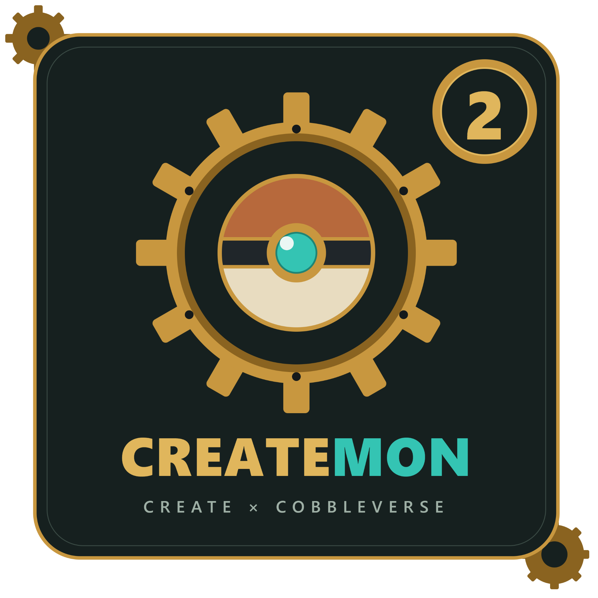

🇬🇧 English | 🇫🇷 [Français](README.md)

# CreateMon 2 — Create x CobbleVerse

**Catch. Build. Automate. Explore.**

---

## Overview

**CreateMon 2** is a Minecraft modpack that brings together the world of **Cobblemon** and the mechanical building and automation possibilities of the **Create** mod.

Set out to explore the world, encounter and catch Pokémon, then build your own mechanical installations. Whether you prefer exploration, collecting or engineering, CreateMon invites you to combine adventure and creativity.

## What's inside

- **Cobblemon** — explore the world and go meet Pokémon.
- **Create** — design mechanisms, production lines and automated systems.
- **Adventure and building** — switch between exploration, progression and creating your own projects.
- **A modded experience** — enjoy a set of mods brought together in a single modpack.

## Installation

1. Download or get the modpack files from this repository.
2. Use a Minecraft launcher compatible with the pack's format.
3. Import the modpack or install its contents by following the launcher's instructions.
4. Check that the Minecraft and mod loader versions match those listed in the pack's files.
5. Launch the game and enjoy CreateMon!

> **Important:** the Minecraft and mod loader versions, as well as any launcher-specific instructions, must be checked in the modpack's files. They are deliberately not listed here until they are confirmed.

## Repository structure

The modpack files are located in the folder:

`Createmon 2 (Create x Cobbleverse)/`

The repository may also contain configuration files and metadata needed to distribute the pack.

## Credits and mod licenses

CreateMon brings together mods created and maintained by their respective authors. Many thanks to them, as well as to the teams and communities that keep the projects used by the modpack alive.

**The MIT license of this repository does not replace the licenses of the mods, software, trademarks, textures, sounds or other third-party content.** Each third-party element remains subject to its own terms. Check the official pages and license files of the projects concerned before any redistribution.

## Contributions

Suggestions, bug reports and contributions are welcome. Before proposing a change, make sure it respects the licenses and terms of the third-party projects concerned.

## License

The original elements of this repository are dedicated to the public domain to the extent permitted by law, under the MIT license. See the [LICENSE](LICENSE.md) file for the full text.

---

**CREATE × COBBLEVERSE**

*Have fun playing CreateMon!*

