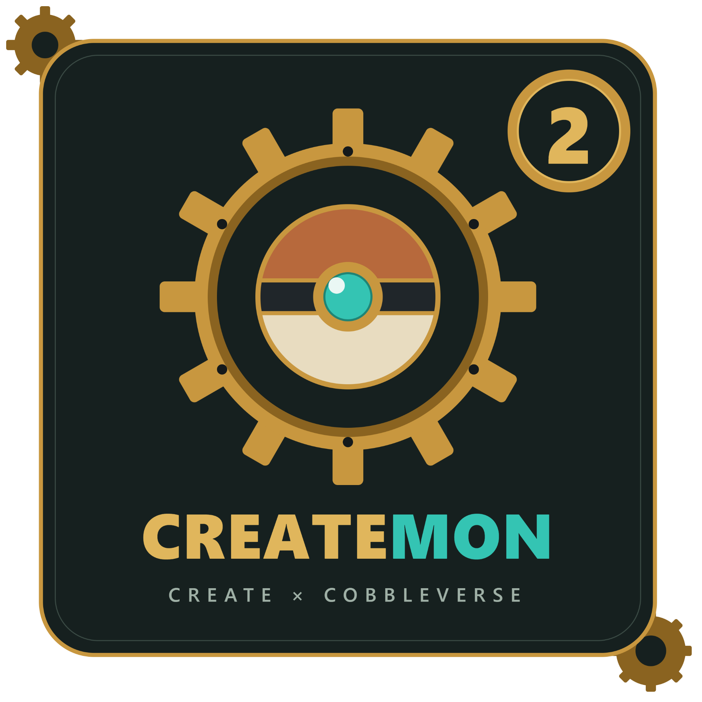

🇫🇷 Français | 🇬🇧 [English](README.en.md)

# CreateMon 2 — Create x CobbleVerse

**Capturez. Construisez. Automatisez. Explorez.**

---

## Présentation

**CreateMon 2** est un modpack Minecraft qui associe l'univers de **Cobblemon** aux possibilités de construction mécanique et d'automatisation du mod **Create**.

Partez à la découverte du monde, rencontrez et capturez des Pokémon, puis développez vos propres installations mécaniques. Que vous préfériez l'exploration, la collection ou l'ingénierie, CreateMon vous invite à faire cohabiter aventure et créativité.

## Au programme

- **Cobblemon** — explorez le monde et partez à la rencontre des Pokémon.
- **Create** — imaginez des mécanismes, des chaînes de production et des systèmes automatisés.
- **Aventure et construction** — alternez entre exploration, progression et création de vos propres projets.
- **Une expérience moddé** — profitez d'un ensemble de mods réunis dans un même modpack.

## Installation

1. Téléchargez ou récupérez les fichiers du modpack depuis ce dépôt.
2. Utilisez un launcher Minecraft compatible avec le format du pack.
3. Importez le modpack ou installez son contenu en suivant les instructions du launcher.
4. Vérifiez que les versions de Minecraft et du mod loader correspondent à celles indiquées dans les fichiers du pack.
5. Lancez le jeu et profitez de CreateMon !

> **Important :** les versions de Minecraft, du mod loader et les éventuelles instructions propres au launcher doivent être vérifiées dans les fichiers du modpack. Elles ne sont volontairement pas indiquées ici tant qu'elles ne sont pas confirmées.

## Structure du dépôt

Les fichiers du modpack se trouvent dans le dossier :

`Createmon 2 (Create x Cobbleverse)/`

Le dépôt peut également contenir des fichiers de configuration et des métadonnées nécessaires à la distribution du pack.

## Crédits et licences des mods

CreateMon réunit des mods créés et maintenus par leurs auteurs respectifs. Un grand merci à eux ainsi qu'aux équipes et communautés qui font vivre les projets utilisés par le modpack.

**La licence MIT de ce dépôt ne remplace pas les licences des mods, logiciels, marques, textures, sons ou autres contenus tiers.** Chaque élément tiers reste soumis à ses propres conditions. Consultez les pages officielles et fichiers de licence des projets concernés avant toute redistribution.

## Contributions

Les suggestions, signalements de bugs et contributions sont les bienvenus. Avant de proposer une modification, vérifiez qu'elle respecte les licences et conditions des projets tiers concernés.

## Licence

Les éléments originaux de ce dépôt sont dédiés au domaine public dans la mesure permise par la loi, selon MIT license. Consultez le fichier [LICENSE](LICENSE.md) pour le texte complet.

---

**CREATE × COBBLEVERSE**

*Have fun playing CreateMon!*

